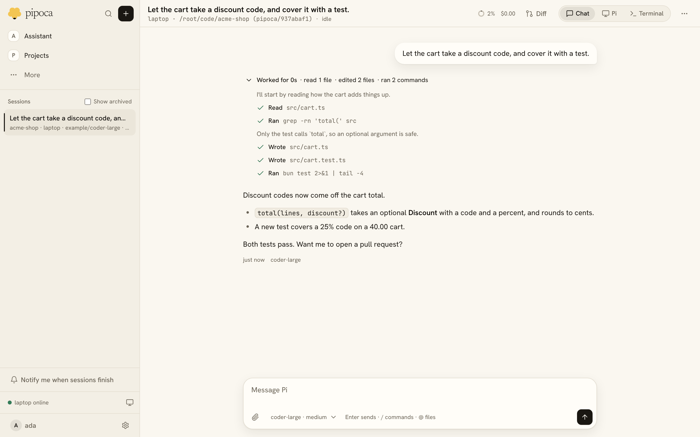
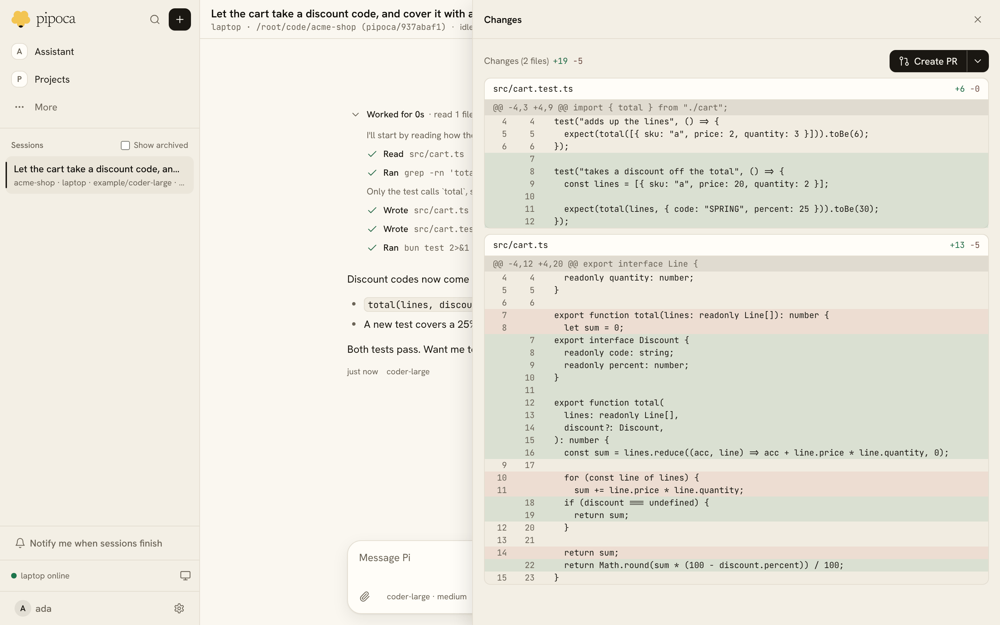
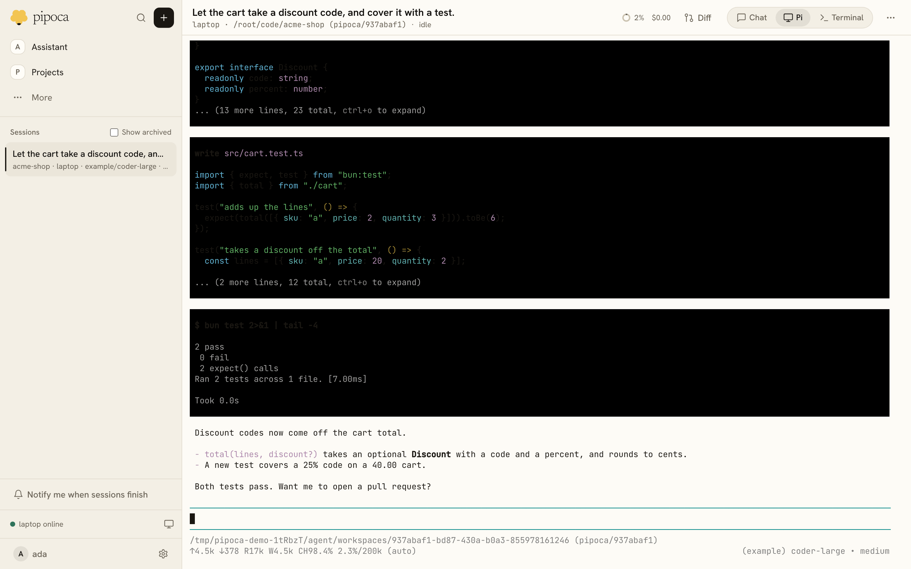
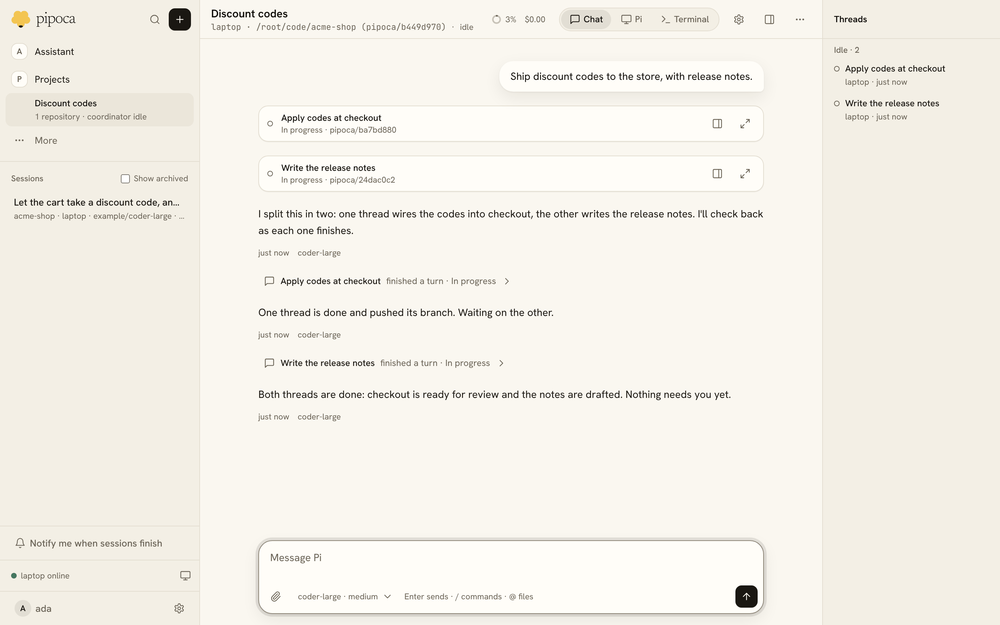
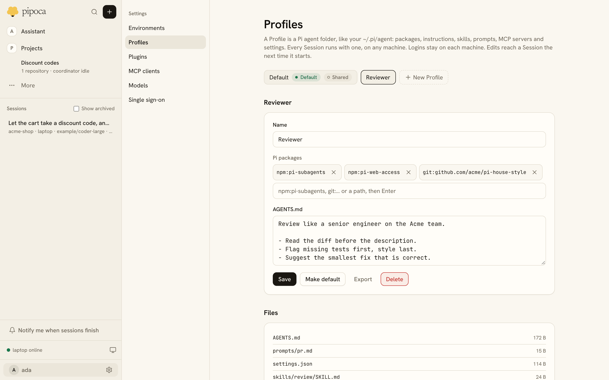
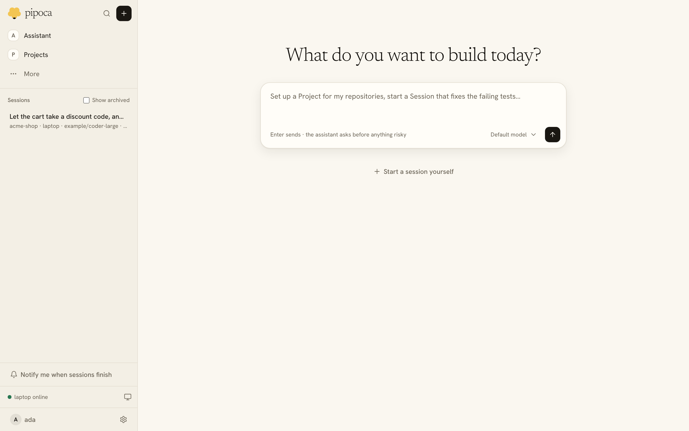
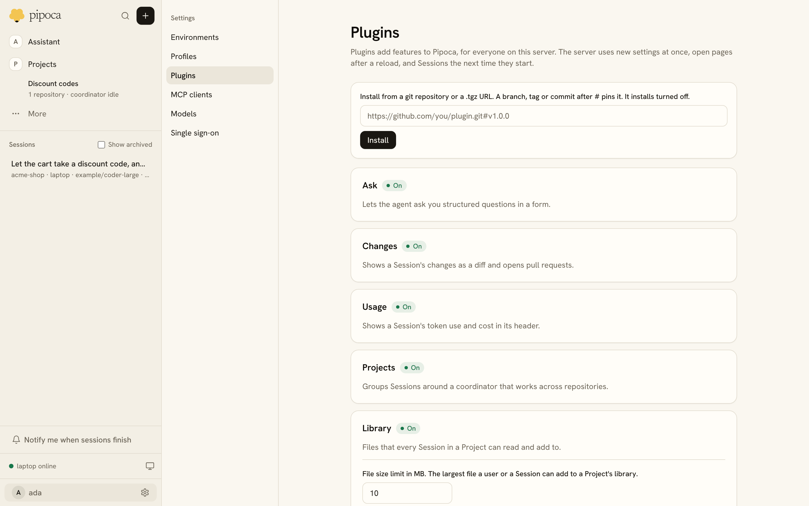
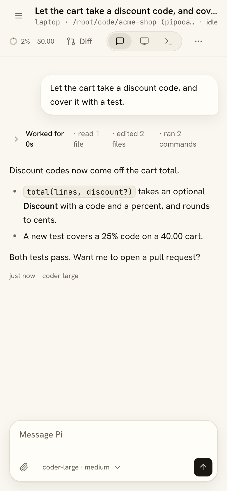

<p align="center">
  <picture>
    <source media="(prefers-color-scheme: dark)" srcset="docs/images/logo-dark.png">
    
  </picture>
</p>

<p align="center">
  Run <a href="https://github.com/earendil-works/pi">Pi</a> coding-agent sessions on your own machines, and pick them up from any browser.
</p>

<p align="center">
  <a href="https://github.com/PedroKlein/pipoca/actions/workflows/ci.yml"></a>
</p>

<picture>
  <source media="(prefers-color-scheme: dark)" srcset="docs/images/session-dark.png">
  
</picture>

Pipoca is a self-hosted control plane for Pi. You start a session from the web, it runs on your laptop, a VM or a Kubernetes pod, and it keeps going when you close the tab. Open it later from another computer or your phone and the whole transcript, the diff and a live terminal are still there.

Pipoca keeps Pi as Pi. Sessions load real Pi packages, skills and extensions, and you can always drop into Pi's own terminal UI. Everything past the small core is a plugin, including Projects, the diff view and single sign-on, so you can turn features off or write your own.

## What you can do with it

### Hand off a task and come back to it

Type what Pi should do, pick a folder or paste a repository URL, and press Enter. Each session gets its own Git worktree or clone on its own branch, so several can work in one repository without stepping on each other. Pi's steps fold into a single "Worked for" line that you can open, and the header shows context use and cost.

Enter queues a message for when Pi finishes its turn, and Ctrl+Enter sends it now. Pi can ask you questions in a form, and a browser notification tells you when a session finishes.

### Review the diff and open a pull request

<picture>
  <source media="(prefers-color-scheme: dark)" srcset="docs/images/changes-dark.png">
  
</picture>

The Changes panel shows what the session changed. Comment on any line and send all the comments back to Pi as one message, or open a pull request from the same panel.

### Drop into Pi's own TUI or a shell

<picture>
  <source media="(prefers-color-scheme: dark)" srcset="docs/images/pi-dark.png">
  
</picture>

The Pi tab runs Pi's terminal UI for the same session, so extensions that only work in a terminal still work. Terminal opens shells in the session's directory, and they survive reloads. Widgets and status lines from Pi extensions also render in the web chat.

### Split bigger work across a Project

<picture>
  <source media="(prefers-color-scheme: dark)" srcset="docs/images/project-dark.png">
  
</picture>

A Project groups work toward one goal across one or more repositories. You talk to its coordinator, which starts a thread session for each piece of work, hears back after every thread turn, and shares Project memory and a file library with the threads. The rail lists the threads and puts the ones that need you first.

### Bring your Pi setup with you

<picture>
  <source media="(prefers-color-scheme: dark)" srcset="docs/images/profiles-dark.png">
  
</picture>

A Profile is a Pi agent folder, like your `~/.pi/agent`: packages, instructions, skills, prompts, MCP servers and settings. Import yours from a folder, a tarball or a git repository, and every session runs with it on any machine. Model logins stay on each machine.

### Ask the assistant

<picture>
  <source media="(prefers-color-scheme: dark)" srcset="docs/images/home-dark.png">
  
</picture>

The home screen talks to the Pipoca assistant. It can start sessions, set up Projects, Environments and Profiles, and even write a plugin for you, and it asks before any tool that changes something. The same tools are served over MCP at `/api/mcp`, so Pi or another MCP client on your laptop can drive Pipoca too.

### Extend it with plugins

<picture>
  <source media="(prefers-color-scheme: dark)" srcset="docs/images/plugins-dark.png">
  
</picture>

Built-in features are plugins you can switch off. Install more from a git repository or a `.tgz` URL. A new plugin installs turned off, and turning it on lists the capabilities it asks for first. A plugin can add server routes, web pages and settings, and Pi extensions or tools to every session. See [docs/plugins.md](docs/plugins.md).

### Check in from your phone

<p align="center">
  <picture>
    <source media="(prefers-color-scheme: dark)" srcset="docs/images/phone-dark.png">
    
  </picture>
</p>

The whole UI works on a phone, terminal included, with a key bar for the keys a phone keyboard lacks, such as Ctrl and Alt.

### Run sessions wherever the work needs

- **Your laptop.** An agent connects out to the server, so the laptop needs no open port. If it sleeps, its sessions catch up when it reconnects.
- **A VM.** The server can run sessions itself, each in a fresh clone on its own branch. See [docs/vm.md](docs/vm.md).
- **Kubernetes.** A Helm chart installs the server, and the kubernetes plugin starts runner pods on demand and deletes them when they go idle.
- **Containers.** An Environment can run each session in a container from an image you pick, with a setup script, variables and encrypted secrets.

Several machines can join one Environment as a pool. A session working in a clone moves to another machine if its own goes away, and picks up from its transcript.

## Quick start

You need [Bun](https://bun.sh) and at least one model you can log in to from Pi.

```sh
git clone https://github.com/PedroKlein/pipoca && cd pipoca
bun install
bun run build
apps/pipoca/dist/pipoca server
```

The server logs a one-time setup link. Open it to create your user. Then, on the Environments page, make an Environment named `laptop` and copy the command it shows, which starts an agent with the Environment's key:

```sh
PIPOCA_KEY=pck_… apps/pipoca/dist/pipoca agent --name laptop --folder ~/code
```

Open New session, pick a checkout under `~/code`, describe the task and press Enter. Log in to a model provider once with `/login` from any session.

## Deploy

**On a VM**, run the compiled binary under systemd and reach it through an SSH tunnel or a reverse proxy. [docs/vm.md](docs/vm.md) walks through it.

**On Kubernetes**, use the chart in `deploy/helm/pipoca`. Every push to main publishes `ghcr.io/pedroklein/pipoca:main`.

```sh
helm install pipoca deploy/helm/pipoca --set url=https://pipoca.example.com
kubectl logs deploy/pipoca | grep setup
```

Put HTTPS in front with your gateway. The chart also supports SAP BTP's Kyma gateway, runner pods, and OpenID Connect sign-in through providers such as SAP IAS, Okta or Google.

The [guide](docs/guide.md) covers every option: server and agent flags, workspaces, plugins, Environments, secrets, containers, runner pools, single sign-on and runner pods.

## How it works

```text
browser ──HTTP/SSE──▶ pipoca server ◀──long-poll + HTTPS/SSE── pipoca agent ──▶ Pi sessions
                      (web UI, SQLite)                          (laptop, VM or pod)
```

- `pipoca server` serves the web UI, stores sessions and a copy of each transcript in SQLite, and relays commands. Server settings live in a plain `pipoca.json` next to the database, so they are easy to set from Helm or by hand.
- `pipoca agent` runs each Pi session in its own process, with the session's Profile. A session that crashes reloads from its transcript without touching the others.
- One binary does both, built with Bun. Each machine keeps its own model logins.

The design is written down in [docs/architecture.md](docs/architecture.md), with the reasoning behind each decision in [docs/adr/](docs/adr/).

## Status

Pipoca is young and built by one person, for their own daily use first. Personal sessions and Projects on a laptop and a VM are done and tested with real models. Kubernetes, authentication, Profiles, the assistant and third-party plugins are working. Expect breaking changes between versions.

Next up are teams: inviting people, shared Environments and Profiles, and multiplayer Projects. [docs/vision.md](docs/vision.md) has the roadmap and non-goals, and [docs/open-questions.md](docs/open-questions.md) lists what isn't decided yet.

## Repository layout

```text
apps/pipoca      the pipoca binary: server and agent
apps/web         the web UI
packages/        protocol, sessions, providers, workspaces, profiles, UI kit, the session host and the plugin host
plugins/         built-in plugins: projects, changes, usage, kubernetes, oidc and more
deploy/helm      the Helm chart
docs/            guide, vision, architecture, design system and decision records
```

## Development

`bun run dev` runs the server with a built-in provider named `cloud` and an agent named `local` that may use this repository's folder, and restarts both when a file under `apps/` or `packages/` changes. Its data lives in `~/.pipoca/dev`.

```sh
bun run dev
bun run format
bun run lint
bun run typecheck
bun test
```

Tests use Pi's faux model provider, so they need no API key. `bun run test:e2e` drives the web UI in headless Chromium; it needs Playwright's browser once (`bun x playwright-core install chromium`). `bun run smoke` checks Pipoca against your own Pi setup with one short prompt; pass `--model provider/id` to pick a cheap model. [AGENTS.md](AGENTS.md) has the coding conventions and [docs/design-system.md](docs/design-system.md) the UI rules.
