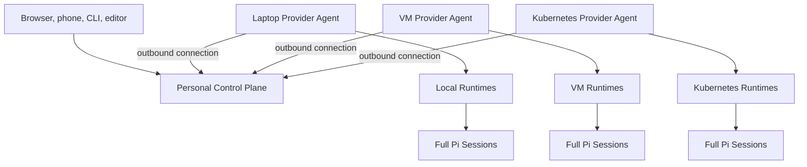
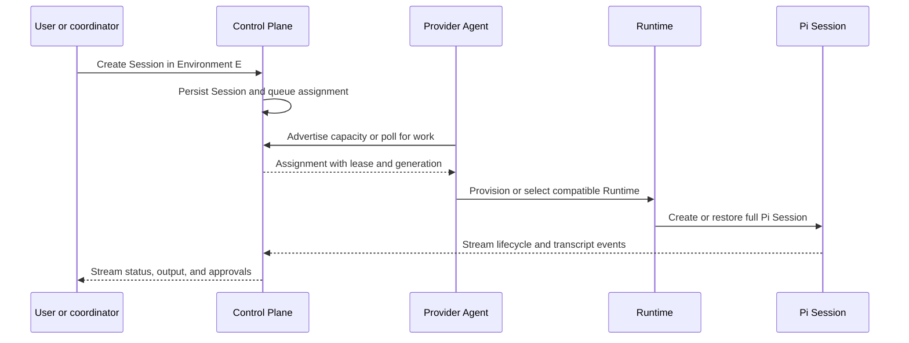
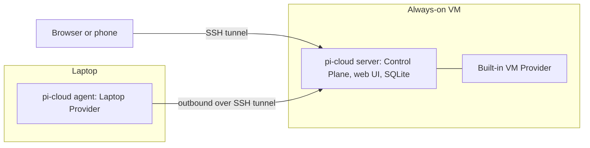

# Pi Cloud working architecture

> Status: working architecture. This records the system shape discussed so far. Interfaces, deployment defaults, protocols, and storage choices remain open.

## Responsibility split

Pi Cloud separates deterministic control from model-driven coordination.

| Part | Responsibility |
|---|---|
| Control Plane | Stores desired state, assigns work, enforces leases, routes messages and approvals, and serves clients |
| Project coordinator | A full Pi Session that interprets a Project goal, creates or reuses Threads, and synthesizes their reports |
| Provider Agent | Connects an execution location to the Control Plane and manages provider-local Runtimes and Workspaces |
| Pi Session | Runs one independent conversation, including tools, extensions, subagents, and workflows |

The Control Plane does not reason about product or code decisions. The Project coordinator does not own infrastructure state or bypass scheduling policy.

## One logical control plane

A personal Cell has one authoritative Control Plane. It may run locally, on an always-on VM, or in Kubernetes. Its placement does not constrain where Sessions execute.

Provider Agents on a laptop, VM, or Kubernetes namespace initiate authenticated outbound connections. This supports machines behind NATs and firewalls without exposing an inbound agent endpoint.



Running a separate authoritative Control Plane on every provider is not part of the current model. That would require conflict resolution for Projects, Session identities, shared memory, assignments, and browser input before the personal product needs that complexity.

A local package may still co-locate the Control Plane and an embedded Provider Agent in one process. They remain separate modules conceptually so the provider can later connect to a remote Control Plane.

"One logical Control Plane" does not require one process forever. The personal version may begin as one server with local storage. A later deployment may run several API replicas over shared metadata and artifact stores while preserving one authoritative resource model.

## Environment and Provider relationship

An Environment describes how a Session should execute: runtime baseline, setup, network policy, variables, secret policy, resources, isolation, capacity, and Workspace behavior.

A Runtime Provider supplies somewhere capable of satisfying that Environment. The exact cardinality remains open: an Environment may bind to one provider or act as a pool served by several equivalent providers. Sessions target an Environment revision rather than a named pod or machine.

A Provider Agent advertises bounded capabilities, for example:

- platform and architecture;
- supported execution modes;
- Workspace drivers;
- maximum concurrency;
- Docker or GPU availability;
- persistence characteristics;
- whether requested network policy can be enforced;
- available Environment revisions.

The Control Plane must reject or visibly weaken unsupported policy instead of claiming enforcement it cannot provide.

## Session assignment flow

A new Session follows this conceptual flow:



The same flow applies to independent Sessions, Project coordinators, and Project Threads. Their relationships differ, not their Pi capabilities.

## Assignments, attempts, and leases

A Session may have several Runtime attempts over its life. Each assignment needs a lease and monotonically increasing generation so only one Runtime may execute the Session.

If a provider disconnects, the Control Plane waits for lease expiry, marks the attempt interrupted, and decides whether the Session can be reconstructed. In v1 a Session can't leave its provider, so a disconnect only marks the provider offline and its Sessions keep running ([ADR 0006](adr/0006-provider-protocol.md)). Late events from an old generation are rejected. Without fencing, a network partition could allow two Runtimes to continue the same Session and Workspace.

Reconstruction restores persisted conversation and files. It does not restore a running shell command, subagent, test process, terminal, or in-memory turn. Interruptions remain visible in Session history.

## State ownership

Pi Cloud has four state classes with different durability.

### Control-plane state

The Control Plane is authoritative for:

- identities and ownership;
- Projects and Thread relationships;
- Profile and Environment revisions;
- Session records, attempts, assignments, and leases;
- status and approval routing;
- shared Project instructions and controlled memory;
- artifact indexes;
- future automation definitions.

The storage substrate remains open. SQLite and filesystem artifacts may be enough for one personal instance; PostgreSQL and object storage may suit a replicated or team deployment. Redis, NATS, and similar infrastructure are not assumed requirements.

### Pi transcript

Pi's native JSONL Session remains the authoritative conversation format while the Session runs. Pi Cloud should replicate, back up, or export it rather than create a competing transcript format.

The exact replication frequency and recovery authority remain open. A provider failure must not make the Control Plane forget that the Session existed.

### Workspace

The provider owns the concrete Workspace realization. The Control Plane stores a stable `workspaceRef`, not a universal path.

The same reference may resolve to:

- a local Git worktree;
- a persistent VM directory;
- a directory on a shared volume;
- a Kubernetes PVC mounted into a Session pod;
- an ephemeral checkout for bounded batch work.

Moving a Session across providers requires an explicit Workspace transfer or reconstruction. It cannot be treated as transparent movement of a live process.

### Live execution

Process memory, shell commands, subagents, terminals, dev servers, and running tests are ephemeral. They survive a browser disconnect while the Runtime remains alive, but not Runtime termination.

## Session lifecycle boundaries

These events have different meanings:

### Client disconnect

Nothing stops. The Runtime continues and the client reconnects through event replay and transcript rehydration.

### Session settles

After Pi reports a clean settled boundary, policy may keep the Session warm, unload its in-memory runtime, or stop a dedicated Runtime. The default policy is unresolved.

### Runtime stops

Persisted transcript and Workspace state remain. Live work is interrupted. On restart, the Session receives a new attempt rather than pretending the process resumed.

Automatic idle eviction is not required for the first product. Keeping a bounded number of personal Sessions warm may be simpler until measurements justify suspension and reconstruction.

## Runtime isolation options

Environment policy may select different execution shapes behind the same Session interface.

### Shared Runtime

One trusted Runtime hosts several independent Pi Session processes or SDK instances. This offers fast startup and shared caches, but Sessions share an operating-system trust boundary and a Runtime failure interrupts several Sessions.

### Dedicated Session Runtime

One pod or container hosts one full Pi Session. Its subagents initially remain inside that Runtime. This improves resource accounting, cancellation, and filesystem/process isolation at the cost of startup latency and more Workspace lifecycle work.

### Batch Runtime

A bounded Job runs one task or turn, publishes durable outcomes, and exits. This may fit schedules, verification, or disposable automation better than interactive Sessions.

### Hardened Runtime

A dedicated pod using gVisor, Kata, or another stronger boundary may serve untrusted repositories or future tenant isolation.

No default isolation policy has been selected. It may be an Environment choice rather than a product-wide choice.

## Deployment topologies

### v1 topology

v1 is a VM-hosted Cell with one laptop provider ([vision](vision.md#scope), [ADR 0005](adr/0005-v1-access-and-model-credentials.md)).



- `pi-cloud server` runs on the VM. It serves the UI, stores Sessions, Projects, Threads, and attempts in SQLite, assigns Sessions to providers, and relays input and output.
- The same process embeds a VM Provider, which uses the same provider interface as a remote agent.
- `pi-cloud agent` runs on the laptop and connects to the server through the tunnel. Its Sessions pause while the laptop sleeps; VM Sessions keep running.
- A Project can place its coordinator on the VM and individual Threads on the laptop.

v2 moves `pi-cloud server` into Kubernetes and adds a Kubernetes provider without changing these roles.

### Local Cell

The Control Plane and Provider Agent run on the same machine. Sessions use local processes and worktrees. If the machine sleeps, the Cell is unavailable.

Kubernetes may be offered through kind or k3d for development, but native local execution remains valuable for emulators, keychains, local databases, and existing tools.

### VM-hosted Cell

An always-on VM hosts the Control Plane and usually a VM Provider Agent. Laptop and Kubernetes providers connect to it. This provides a stable URL and allows coordinator Sessions to remain available while a laptop is offline.

A lightweight distribution such as k3s may suit a durable single-node VM better than treating kind storage as permanent infrastructure.

### Kubernetes-hosted Cell

A personal namespace hosts the Control Plane and a Kubernetes Provider Agent. Other providers still connect outbound. Kubernetes Environments may use shared runners, dedicated Session pods, Jobs, different node classes, or stronger RuntimeClasses.

A possible namespace shape is:

```text
personal namespace
  control-plane Deployment
  metadata store or PVC
  Kubernetes Provider Agent
  shared runner StatefulSet, if used
  on-demand Session Pods or Jobs, if used
  Workspace PVCs
  Secrets
  Ingress
```

This shape is illustrative, not a committed deployment specification.

A stronger Kubernetes isolation profile should consider these controls before it is described as a sandbox:

- no host Docker socket;
- no `hostPath` Workspace storage;
- non-root containers and restricted Pod Security;
- no Kubernetes service-account token inside Session pods unless a task explicitly requires one;
- separate Workspace volumes and secret scope;
- resource quotas and limits;
- default-deny network policy with explicit egress;
- an optional stronger RuntimeClass such as gVisor or Kata.

Namespaces and RBAC help separate users and projects, but they are not by themselves a complete sandbox for arbitrary agent code.

A pragmatic early team deployment may give each developer a separate personal Cell on a VM or in a namespace, with separate Pi configuration, credentials, Sessions, Workspaces, caches, Secrets, and quotas. A later Team Hub can federate those Cells before Pi Cloud attempts to make one Pi Runtime a hard multi-tenant boundary.

## Projects on top of Sessions

A Project contains one coordinator Session and zero or more Thread Sessions. A Thread owns one area of work and reports structured state back to the Project. The coordinator sees reports rather than automatically ingesting every worker transcript.

Expected report classes are:

- progress;
- question or approval need;
- decision proposal;
- completion handoff;
- failure and recoverable state.

Project memory belongs to Control Plane state, not a writable directory shared by Thread Workspaces. Its write, review, versioning, and conflict semantics remain open.
