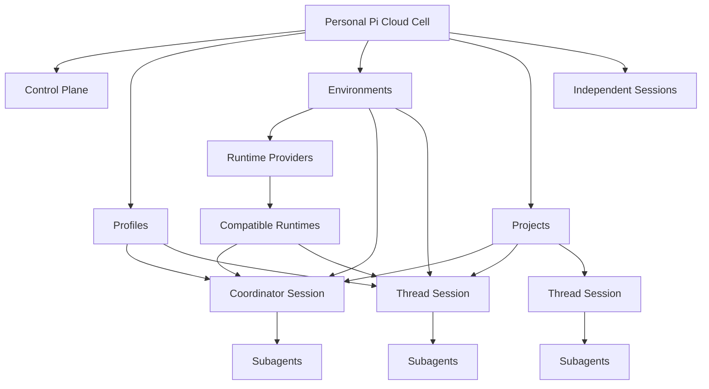
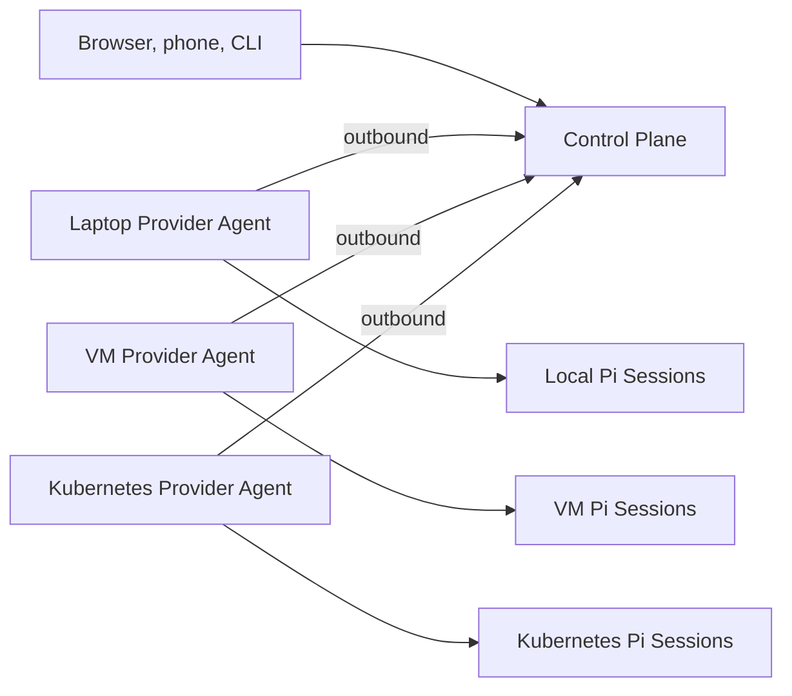

# Pi Cloud concepts

> Status: working model. These terms exist to keep future discussions precise. Their interfaces and storage formats are not decided.

## Resource model

### Cell

One logical Pi Cloud installation. The first Cell has one owner and one authoritative control plane. It may use several Runtime Providers.

### Control Plane

Deterministic infrastructure software that stores desired state, assigns work, enforces leases, routes messages and approvals, and exposes the web/API surface. It does not reason about a Project goal; a coordinator Pi session does that.

### Profile

A versioned description of Pi personalization: packages, extensions, skills, prompts, instructions, MCP servers, model configuration, and preferences. Required installation policy, Environment overlays, trusted project configuration, and temporary session overrides may layer over a Profile.

### Runtime Provider

An adapter that supplies execution capacity. Expected provider types include a local host agent, a remote VM agent, and a Kubernetes namespace controller. Its Provider Agent connects outbound, advertises capabilities and capacity, claims assignments, manages provider-local Runtimes and Workspaces, and streams Session events.

### Environment

A versioned execution definition served by compatible Runtime Providers. It may define a runtime image or host profile, setup, networking, variables, secret policy, resources, isolation, capacity, and Workspace driver.

Sessions target an Environment, not a specific machine or pod. In v1 an Environment has exactly one Provider ([ADR 0014](adr/0014-concept-map-and-environments.md)). Whether it can later form a pool across equivalent Providers remains open.

### Runtime

A live realization of an Environment capable of hosting one or more sessions. Depending on Environment policy, a Runtime may be a local process host, a shared runner pod, a dedicated session pod, or a bounded Job.

### Repository

A Git repository a Session works on, identified by its clone URL. A Session may have several, checked out side by side in its Workspace ([ADR 0015](adr/0015-projects.md)).

### Workspace

The durable filesystem and repository state owned by a session. A Workspace may resolve to a local Git worktree, VM directory, shared-volume directory, or Kubernetes PVC. The control plane stores a stable reference rather than assuming one universal path.

### Session

One full Pi conversation with its own transcript, context, model state, Profile revision, Environment revision, Workspace, active attempt, and lifecycle. A Session may be independent or related to a Project.

The Session is where the other concepts meet. Project, Repository, Environment and Profile are peers that a Session points at; none contains another ([ADR 0014](adr/0014-concept-map-and-environments.md)).

### Attempt

One Runtime assignment for a Session. A replacement Runtime creates a new attempt. This records interruptions honestly and provides fencing against two Runtimes executing the same Session after a network partition.

### Project

A long-running goal with one coordinator Session, zero or more thread Sessions, shared instructions, memory, one or more repositories, and a default Environment ([ADR 0015](adr/0015-projects.md)). The coordinator is model-driven and interprets the goal; it is not the deterministic Control Plane.

### Thread

A full Session attached to a Project to own one area of work. A Thread can run its own subagents and workflows. Its detailed transcript stays in the Thread. The coordinator gets a short notice when the Thread finishes a turn or changes state, and the Thread can message the coordinator directly. The user can also talk to a Thread directly.

### Subagent

Child execution owned by one Session. Subagents are useful internal implementation machinery, not Project Threads.

### Automation

A future capability that starts or continues ordinary Session turns in response to time, webhooks, APIs, or prior run results. It should use the same run interface as a human or Project coordinator.

## Relationships

## Control-plane topology

There is normally one logical control plane per Cell. Provider Agents initiate authenticated outbound connections so laptops, VMs, and namespace-scoped cluster agents can work behind NATs and firewalls.

The control plane owns identity, Project and Session records, Environment and Profile revisions, assignments, leases, shared Project state, and browser event routing. Providers own execution, Pi processes, Workspace realization, and provider-local credentials. See [Working architecture](architecture.md) for the detailed responsibility and lifecycle model.

## Session configuration

The current working precedence is:

1. mandatory Pi Cloud session bridge;
2. installation policy;
3. selected Profile revision;
4. selected Environment overlay;
5. trusted project configuration;
6. explicit Session overrides.

The exact merge rules remain undecided. The effective configuration should be inspectable and reproducible.

## Environment selection

The current working precedence is:

1. explicit Session or Thread override;
2. Project default Environment;
3. user default Environment;
4. installation default.

A Project may eventually select different defaults for its coordinator and worker Threads.

## Execution isolation

Environment policy may support several modes behind one Session interface:

| Mode           | Likely implementation                                       | Intended use                       |
| -------------- | ----------------------------------------------------------- | ---------------------------------- |
| Shared process | Several Pi session processes in one trusted Runtime         | Personal fast path                 |
| Dedicated pod  | One full Session per pod, with subagents inside it          | Isolation and resource accounting  |
| Batch Job      | Fresh bounded execution that publishes outcomes before exit | Schedules and verification         |
| Hardened       | Dedicated sandboxed pod or microVM                          | Untrusted code or stronger tenancy |

No default mode has been chosen. See [Environments](environments.md) for setup, revision, network, secret, capability, and Workspace policy.

## Durable and ephemeral state

Control-plane state includes identifiers, relationships, revisions, assignments, status, shared memory, and artifact indexes.

Pi transcripts remain native JSONL and should be replicated or backed up without inventing a competing transcript format.

Workspaces remain provider-managed durable state. Live processes, shell commands, and subagents are ephemeral. Runtime reconstruction restores persisted conversation and files, not process memory.

See [Extensibility](extensibility.md) for the Profile, Session bridge, platform extension, automation, and collaboration model.
